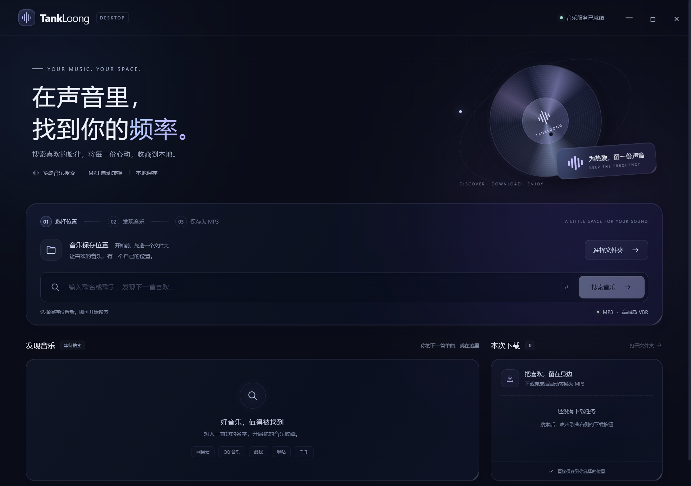

# TankLoong

**在声音里，找到你的频率。**

TankLoong 是一个 Windows 桌面音乐下载器：输入歌名或歌手，同时搜索咪咕、网易云、QQ 音乐、酷我、千千五个来源，选一首即可下载并自动转换成 MP3，保存到你指定的文件夹。界面使用 Electron + 原生 HTML/CSS 重建，深色液态玻璃质感。

[](https://github.com/IAMCODEMAN/TankLoong/releases/latest)
[](#系统要求)
[](https://www.electronjs.org/)
[](#许可证与来源)



## 下载

前往 **[Releases](https://github.com/IAMCODEMAN/TankLoong/releases/latest)** 下载最新版本，两种形式任选其一：

| 文件 | 说明 |
| --- | --- |
| `TankLoong-Setup-3.0.0.exe` | **安装版**：双击安装，写入开始菜单，可从「应用和功能」卸载 |
| `TankLoong-3.0.0-win-x64-portable.zip` | **免安装版**：解压到任意文件夹，双击 `TankLoong.exe` 运行 |

两个包的应用内容一致，都已内置 Electron、Python 音乐服务、musicdl 与 FFmpeg，**目标机器不需要安装 Python、Node.js 或 FFmpeg**。

> **SmartScreen 提示**：本版本未做代码签名，Windows 可能显示「已保护你的电脑 / 未知发布者」。可点击「更多信息」→「仍要运行」。如果不放心，可以下载源码自行构建。

### 系统要求

- Windows 10 / 11，64 位
- 约 1 GB 磁盘空间（安装版解压后）
- 下载 MP3 需要能访问对应音乐平台的网络

## 使用

1. **选择文件夹** — 首次使用先点「选择文件夹」，指定 MP3 保存位置；下次启动会提示上次使用的目录，但仍需你确认。
2. **搜索音乐** — 输入歌名或「歌名 + 歌手」，五个来源并行搜索，结果会陆续出现，单次搜索最多等待约 35 秒。
3. **下载为 MP3** — 点击歌曲右侧下载按钮，界面依次显示「等待下载 → 下载中 → 转为 MP3 → 已完成」；完成后可直接「在文件夹中显示」。

没有可用音频地址的搜索结果仍会显示，但下载按钮禁用。下载失败会显示原因，可以重试。

## 使用限制

- 一次只下载一首（排队串行），同名文件自动编号；已存在的文件不会被覆盖。
- 搜索结果与下载记录只保留在当前会话，不恢复上次队列。
- 没有歌单、账号登录、播放器、托盘和复杂设置面板——这一版只做「搜索 → 下载 → 转 MP3」。
- 上游音乐平台的接口与可用性随时可能变化，部分来源返回失败或超时属于预期情况，稍后重试即可；不保证任何歌曲都能成功下载。
- MP3 由 FFmpeg `libmp3lame -q:a 2`（VBR）编码，音质上限取决于原始音源，转码不会变好。

## 技术实现

| 层 | 实现 |
| --- | --- |
| 桌面外壳 | Electron 39，无边框窗口 + 自绘标题栏 |
| 渲染界面 | 原生 HTML / CSS / JavaScript，深色液态玻璃风格 |
| 音乐服务 | Python JSON Lines 子进程（PyInstaller 打包为独立 exe） |
| 搜索与下载 | [musicdl](https://github.com/CharlesPikachu/musicdl) 2.13.6（咪咕 / 网易云 / QQ / 酷我 / 千千） |
| 转码 | 内置 FFmpeg 9.0.1 Essentials（gyan.dev），`libmp3lame` |
| 打包 | electron-builder 26（安装版 NSIS + 目录版，目录版再压缩为免安装 zip） |

**安全设计**：渲染进程启用 `contextIsolation` 与 `sandbox`、关闭 `nodeIntegration`，只通过限定的 preload API 与主进程通信；页面 CSP 禁止外部连接；禁止窗口导航和新窗口；IPC 校验调用方；歌曲信息全部以文本节点渲染，不执行 HTML。不启动本地 HTTP 服务，不加载任何外部网页。

**数据位置**：设置 `%APPDATA%\TankLoong\settings.json`（上次目录）；运行日志与临时任务在 `%APPDATA%\TankLoong\backend\`。应用不包含账号系统、不上传使用数据、无遥测。

项目结构：

```text
electron/                 Electron 主进程、隔离 preload、Python 子进程桥接
ui/                       界面：index.html / styles.css / app.js
src/backend.py            音乐服务协议层（JSON Lines，搜索与下载调度）
src/core.py               musicdl 适配、FFmpeg 转码、文件命名与日志脱敏
tests/                    Python 核心/后端测试、Node 通信测试
tools/                    启动脚本、Electron 界面冒烟测试、发布包联网验证
docs/                     界面截图、爬虫核对报告
licenses/                 第三方许可证全文
ffmpeg/                   内置 FFmpeg 可执行文件与许可证
build_release.ps1         一键构建 Python 服务 + Electron 目录版
```

## 从源码运行

需要 Windows、Node.js 20+、Python 3.13。FFmpeg 可使用系统 PATH 中的版本（需支持 `libmp3lame`），也可以放在 `ffmpeg/bin/ffmpeg.exe`。

```powershell
python -m venv .venv
.venv\Scripts\python.exe -m pip install -r requirements.txt
npm.cmd ci
npm.cmd start
```

如果 `npm.cmd ci` 下载 Electron 时连接中断，可在当前 PowerShell 会话设置镜像后重试：

```powershell
$env:ELECTRON_MIRROR='https://npmmirror.com/mirrors/electron/'
npm.cmd ci
```

## 构建发布包

源码仓库不存放第三方二进制（`ffmpeg/bin/` 与 `release/`、`dist/` 都在 .gitignore 中）。要本地构建发布包，先从 [gyan.dev](https://www.gyan.dev/ffmpeg/builds/) 下载 FFmpeg Essentials（需支持 `libmp3lame`），把 `ffmpeg.exe` 放到 `ffmpeg/bin/`，然后：

```powershell
# 目录版（Electron + Python 服务），输出 release\win-unpacked\TankLoong.exe
powershell -ExecutionPolicy Bypass -File .\build_release.ps1

# 安装版，输出 release\TankLoong Setup 3.0.0.exe
node node_modules\electron-builder\cli.js --win nsis --x64
```

`release/win-unpacked/` 必须整目录分发（Electron、后端服务、FFmpeg 都在其中）。

## 验证

```powershell
.venv\Scripts\python.exe -m pytest -q   # 核心 / 后端 / 中文路径 / 失败清理等
npm.cmd test                            # Python 子进程通信与退出处理
npm.cmd run test:ui                     # 真实 Electron 窗口交互（目录闸门、转义、重试、布局）
node tools\smoke-live.cjs               # 可选：发布包真实联网搜索 + 下载 + 完整解码
```

当前记录的验证结果：

- Python 测试 **29 passed**：真实编码、完整解码、中文路径、失败清理、同名不覆盖、大 stderr 不死锁。
- Node 通信测试 **2 passed**。
- Electron 界面测试通过：先选目录的限制、文本安全渲染、不可下载条目、失败重试、成功状态、迟到事件不回退、940px 小窗口不横向溢出。
- 发布包联网实测：搜索「晴天」返回 16 条可下载结果，实际下载并生成 5,956,974 字节 MP3，用包内 FFmpeg 完整解码校验成功。

其中界面测试的搜索/下载状态使用明确标记的测试数据；`docs/screenshots/` 里文件名带 `test` 的截图是测试场景，不是联网证据。真实联网验证的结果会随平台接口变化。

## 许可证与来源

- **本项目代码**：PolyForm Noncommercial License 1.0.0（见 [LICENSE](LICENSE)），仅限非商业用途。
- **musicdl 2.13.6**（[CharlesPikachu/musicdl](https://github.com/CharlesPikachu/musicdl)）：PolyForm-Noncommercial-1.0.0。本项目的搜索与下载能力来自 musicdl，不是重新实现的平台爬虫，也不是上游最新版的完整同步副本（逐文件核对见 `docs/technical-assessment.md`）。许可证全文在 `licenses/`。
- **FFmpeg 9.0.1 Essentials**（[gyan.dev](https://www.gyan.dev/ffmpeg/builds/)）：GPLv3，许可证见 `ffmpeg/LICENSE.txt`，源码见 [ffmpeg.org](https://ffmpeg.org/)。
- **液态玻璃 CSS 技法**：改造自 [Liquid Glass Effect](https://github.com/kevinbism/liquid-glass-effect)（MIT），全文见 `licenses/`。布局、排版、唱片图形为本项目新写。
- **Electron / Chromium / Node.js**：保留各自许可证，发布包内已附带 `LICENSE.electron.txt` 与 `LICENSES.chromium.html`。
- 其他第三方组件声明见 `THIRD_PARTY_NOTICES.txt`。

## 合规提醒

TankLoong 只做「搜索公开结果并下载到本地」，**不提供、也不试图提供任何绕过付费墙或 DRM 的能力**，不是音乐平台官方客户端。请只下载你有权保存的音频，并遵守各音乐平台的服务条款与当地法律。本项目以非商业许可证发布，不得用于商业目的。

如果你只想合法便捷地听歌，建议优先使用各平台的官方客户端或会员服务。
